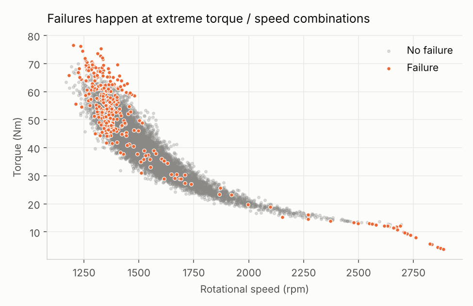
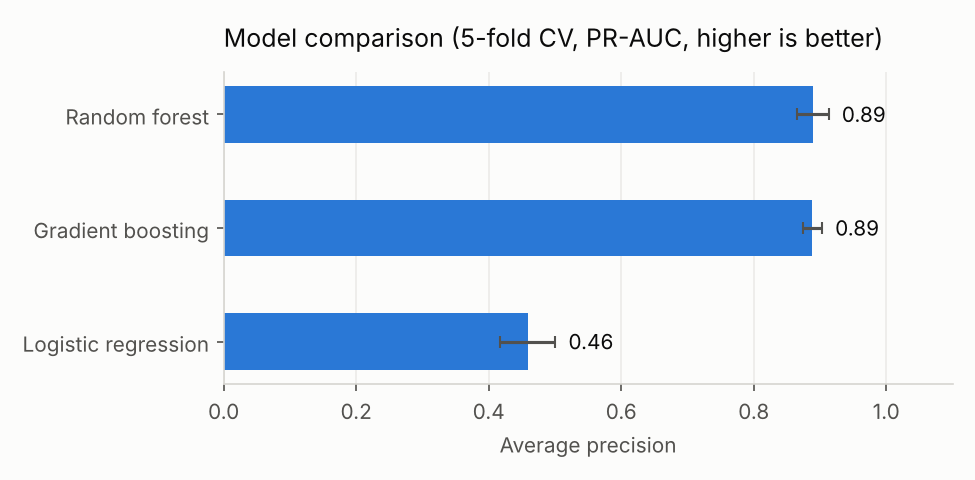
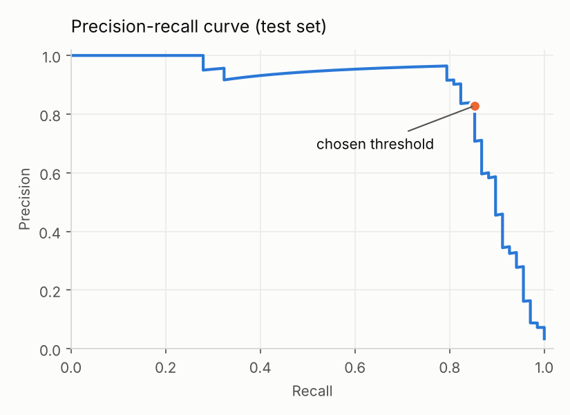
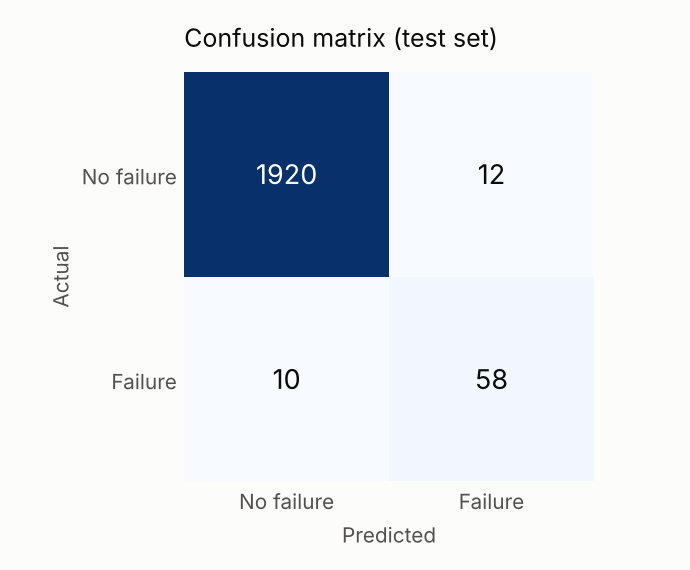
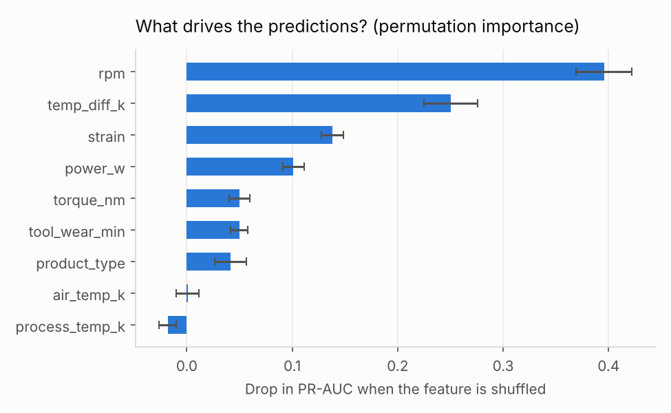
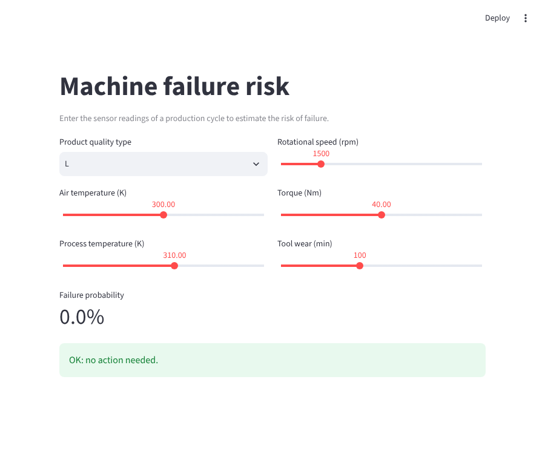

# Predictive Maintenance: predicting machine failures with machine learning

Unplanned machine breakdowns stop production, waste parts and are expensive to repair.
This project uses sensor data from a milling machine to **predict whether a production
cycle will end in a failure**, so that maintenance can be scheduled *before* it happens.

It covers the full data-science workflow: exploration, feature engineering based on the
physics of the machine, model comparison, a cost-based decision threshold, explainability,
and a small web app to use the model.



## Results

| | Value (test set, 2,000 unseen cycles) |
|---|---|
| Best model | Random forest |
| PR-AUC (average precision) | **0.87** |
| Failures detected (recall) | **85%** (58 of 68) |
| Alerts that were real failures (precision) | **83%** |
| False alarms | 12 out of 1,932 normal cycles |
| Estimated maintenance cost vs. doing nothing | **−84%** (112 vs 680 cost units) |

The cost estimate assumes that a missed failure costs 10× more than an unnecessary
preventive inspection (see [Decision threshold](#4-decision-threshold-based-on-cost)).

## Dataset

[AI4I 2020 Predictive Maintenance Dataset](https://archive.ics.uci.edu/dataset/601/ai4i+2020+predictive+maintenance+dataset)
(UCI Machine Learning Repository, CC BY 4.0): 10,000 production cycles with

- product quality type (L / M / H),
- air and process temperature (K),
- rotational speed (rpm), torque (Nm) and tool wear (min),
- whether the cycle ended in a machine failure (**3.4% of cycles**).

The data is downloaded automatically the first time you run the code.

## Approach

### 1. Avoiding data leakage
The dataset also contains the *type* of failure (tool wear, heat dissipation, power,
overstrain, random). These columns are only known **after** a failure, so they are
removed from the inputs. Keeping them would give a near-perfect but useless model.

### 2. Feature engineering from physics
Three features are built from the raw sensors, each linked to a failure mechanism:

| Feature | Formula | Failure it helps detect |
|---|---|---|
| `temp_diff_k` | process temp − air temp | heat dissipation |
| `power_w` | torque × rpm × 2π / 60 | power failure |
| `strain` | tool wear × torque | overstrain |

### 3. Handling class imbalance and choosing the right metric
Only 3.4% of cycles fail, so a model that always predicts "no failure" is 96.6% accurate
and completely useless. Instead of accuracy, models are compared with **average
precision (PR-AUC)**, and the rare class is re-weighted during training.

Three models are compared with 5-fold stratified cross-validation:



Tree-based models clearly beat logistic regression because failures happen in
**non-linear regions** (very low *or* very high power, see the map above).

### 4. Decision threshold based on cost
A model outputs a probability; the business needs a yes/no decision. The threshold is
chosen to minimise `10 × missed failures + 1 × false alarms`, using out-of-fold
predictions on the training set (the test set is never used for any choice).

 

### 5. Explainability
Permutation importance shows which inputs the model relies on. Two of the engineered
features (`temp_diff_k`, `strain`) are among the most important, which confirms that the
physics-based features help.



## Try it

```bash
git clone https://github.com/samy-ouali/predictive-maintenance-ml.git
cd predictive-maintenance-ml
python -m venv .venv && source .venv/bin/activate   # Windows: .venv\Scripts\activate
pip install -r requirements.txt

python -m src.train          # download data, train, evaluate, save model + charts
python -m pytest             # run the unit tests
python -m src.predict --type L --air 300 --process 310 --rpm 1300 --torque 65 --wear 200
streamlit run app/streamlit_app.py   # web interface
```



## Project structure

```
├── app/streamlit_app.py   # web interface
├── src/
│   ├── data.py            # download + cleaning
│   ├── features.py        # physics-based feature engineering
│   ├── train.py           # model comparison, threshold, evaluation, explainability
│   ├── predict.py         # predict the risk for new sensor readings
│   └── plots.py           # charts
├── tests/                 # unit tests (pytest)
└── reports/               # metrics.json + figures
```

## Limitations and next steps

- The dataset is **synthetic** (generated to mirror a real machine), so real sensor data
  would be noisier.
- "Random failures" (about 0.1% of cycles) are by definition unpredictable from sensors.
- The 10:1 cost ratio is an assumption; in a real factory it would come from maintenance
  and downtime costs.
- Next steps: predict the **type** of failure, tune hyperparameters, and monitor the model
  over time (data drift).

## Author

Samy Ouali, BSc Information Systems student at the University of Geneva.
